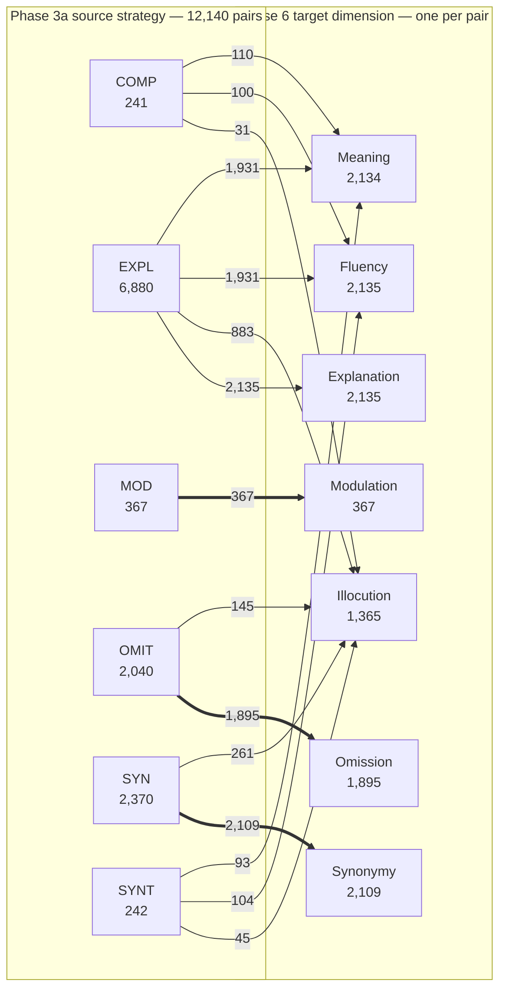

# Seven-axis weak-supervision corpus

[Phase 6 README](../README.md) · [degradation methodology](meaning_degradation.md) · [combined pilot report](PILOT_REPORT.md)

## Methodology by dimension

| Dimension | Methodology |
|---|---|
| Meaning | [Meaning degradation](meaning_degradation.md) |
| Fluency | [Fluency degradation](fluency_degradation.md) |
| Omission | [Omission degradation](omission_degradation.md) |
| Synonymy | [Synonymy degradation](synonymy_degradation.md) |
| Modulation | [Modulation degradation](modulation_degradation.md) |
| Illocution | [Illocution degradation](illocution_degradation.md) |
| Explanation | [Explanation degradation](explanation_degradation.md) |

## Purpose

Phase 6 builds controlled English training pairs for `MEANING`, `FLUENCY`, `OMIT`, `SYN`, `MOD`, `ILLOC`, and `EXPL`. It is synthetic weak supervision, not human gold data. The human-annotated Simplicity-DA, Human-Likert, AssetAnn, and SimpEval-2022 corpora remain reserved for final evaluation.

Every selected `canonical_pair_id` is used once and receives one `target_axis`. `source_strategy` retains the single Phase 3a category found in the simplified pair; it is not overwritten by the degradation target.

## Inputs and assignment

The 12,140 input pairs are the intersection of English Phase 2b `target_simple_v1` and the strict, single-strategy Phase 3a candidates. They are non-identical, have no markup, contain an 8–45-token original, come from WikiAutoEN or Wikipedia–Vikidia, and exclude evaluation corpora. Each pair is assigned exactly once.



Arrow labels are pair counts. Thick arrows mark direct source-strategy-to-target assignments. Meaning and Fluency accept applicable unassigned pairs; Illocution additionally requires an explicit question, modality, request, or certainty cue. `MOD` pairs are protected for Modulation.

## Generation and audit gate

Prompts are versioned per axis under `prompts/`. Qwen2.5-7B-Instruct is pinned at `a09a35458c702b33eeacc393d103063234e8bc28` and runs with greedy decoding, 4-bit NF4, bfloat16 computation, and resumable hash shards.

The frozen 50-pair Meaning pilot is not regenerated. The first multi-axis generation contains 50 pairs for each of the other six axes. Human audit records whether the simplified version is acceptable, whether exactly one target-axis degradation was made, and—outside Meaning—whether propositional meaning was preserved.

Full generation is blocked until every axis reaches:

- at least 90% acceptable simplified versions;
- at least 85% valid single-axis automatic degradations.

Failed axes revise only their detector or prompt and rerun their pilot. After acceptance, each pair yields a simplified instance scored `1` and a degraded instance scored `0` for its assigned axis only. No labels are inferred for the other axes. Train/validation is 90/10 by a stable hash of `canonical_original_id`; related pairs and both variants cannot cross splits. There is no synthetic test split.

## Reproduction

```bash
python -m phase6_degraded_corpus.src.selection.select_multi_axis_inputs \
  --config phase6_degraded_corpus/configs/experiments/multi_axis_en_v1.json

python -m phase6_degraded_corpus.src.planning.plan_multi_axis_degradations \
  --config phase6_degraded_corpus/configs/experiments/multi_axis_assignment_v1.json

sbatch phase6_degraded_corpus/jobs/submit_multi_axis_pilot_gpu.sh

python -m phase6_degraded_corpus.src.generation.consolidate_generations \
  --manifest phase6_degraded_corpus/runs/multi_axis_en_v1/assignment/pilot_manifest.jsonl \
  --shards phase6_degraded_corpus/runs/multi_axis_en_v1/generation/pilot_shard_*.jsonl \
  --output phase6_degraded_corpus/runs/multi_axis_en_v1/generation/pilot_consolidated.jsonl \
  --report phase6_degraded_corpus/runs/multi_axis_en_v1/generation/consolidation_manifest.json

python -m unittest discover -s phase6_degraded_corpus/tests -v
```

Run products, model responses, audits, and training data remain under `phase6_degraded_corpus/runs/multi_axis_en_v1/` and are ignored by Git. Versioned code, configs, prompts, tests, and methodology are committed.
