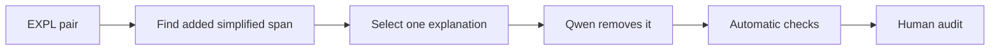

# Explanation degradation

[Methodology index](MULTI_AXIS_CORPUS.md) · [pilot report](PILOT_REPORT.md)

## Goal

Remove exactly one helpful explanation added by the simplified version. The simplified version receives `EXPL = 1`; the degraded version receives `EXPL = 0`.

## Eligible pairs

Only pairs with the single Phase 3a `source_strategy = EXPL`.

## Degradation workflow

The detector proposes simplified-version tokens absent from the original. Qwen removes one candidate with [`expl_degradation_v1.json`](../prompts/expl_degradation_v1.json).

## Acceptance checks

- removed material is a helpful explanation
- necessary facts and grammar remain intact
- no other simplification operation changes

## Pilot evaluation

| Automatic result | Count | Rate |
|---|---:|---:|
| Good | 39 | 78% |
| Medium | 8 | 16% |
| Failed | 3 | 6% |

Automatic structural triage of 50 cases; semantic human audit is pending.

## What we learned

This axis had the strongest automatic result, although added tokens are not always explanatory.

**Next change:** Detect contiguous added spans and classify explanatory function before deletion.
