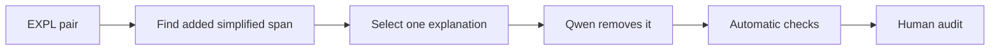

# Explanation degradation

[Methodology index](MULTI_AXIS_CORPUS.md) · [pilot report](PILOT_REPORT.md)

## Goal

Remove exactly one helpful explanation added by the simplified version. The simplified version receives `EXPL = 1`; the degraded version receives `EXPL = 0`.

## Eligible pairs

Only pairs with the single Phase 3a `source_strategy = EXPL`.

## Degradation workflow



### Workflow blocks

| Block | Main idea |
|---|---|
| A — Input | A pair whose only detected source strategy is EXPL. |
| B — Detect | Find content added in the Simplified sentence but absent from the Original. |
| C — Select | Choose one added span that genuinely explains an original concept. |
| D — Generate | Qwen removes only that explanation. |
| E — Check | Verify substantive deletion, matching operation, and declared span. |
| F — Audit | Confirm explanatory support decreased while necessary facts and grammar remained. |

The pilot detector proposes Simplified tokens absent from the Original. Qwen removes one candidate span; human review determines whether it was truly explanatory.

## Prompt used in the pilot

Exact version: [`expl_degradation_v1.json`](../prompts/expl_degradation_v1.json).

<details>
<summary>Show prompt</summary>

**System**

```text
You create controlled negative examples for text-simplification research. Return only one valid JSON object. Do not add commentary.
```

**User template**

```text
Original: {original}
Clean simplification: {clean_simplification}
Assigned operation: {assigned_operation}
Candidate explanation: {target_cue}

Remove exactly one helpful explanation added by the clean simplification. Keep the remaining sentence grammatical and preserve meaning, omission, synonymy, modulation, and illocution. Do not introduce new facts. Return keys degraded_simplification, changed_span, replacement_span, operation_type, and brief_verification. operation_type must be exactly {assigned_operation}.
```

</details>

## Acceptance checks

- removed material is a helpful explanation
- necessary facts and grammar remain intact
- no other simplification operation changes

## Pilot evaluation

| Automatic result | Count | Rate |
|---|---:|---:|
| Good | 35 | 70% |
| Medium | 8 | 16% |
| Failed | 7 | 14% |

Automatic structural triage of 50 cases; semantic human audit is pending.

## What we learned

This axis had the strongest automatic result, although added tokens are not always explanatory.

**Next change:** Detect contiguous added spans and classify explanatory function before deletion.
