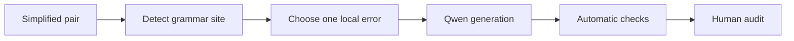

# Fluency degradation

[Methodology index](MULTI_AXIS_CORPUS.md) · [pilot report](PILOT_REPORT.md)

## Goal

Introduce exactly one local grammatical error without changing meaning or another simplification operation. The simplified version receives `FLUENCY = 1`; the degraded version receives `FLUENCY = 0`.

## Eligible pairs

Any unassigned single-strategy pair whose simplified version contains an auxiliary, determiner, preposition, or at least five words.

## Degradation workflow



### Workflow blocks

| Block | Main idea |
|---|---|
| A — Input | A Simplified sentence from an unassigned single-strategy pair. |
| B — Detect | Locate an auxiliary, determiner, preposition, or safe local word-order site. |
| C — Choose | Assign exactly one grammatical error type. |
| D — Generate | Qwen changes only that local form, not the facts or vocabulary meaning. |
| E — Check | Reject copies, formatting-only edits, wrong operations, or unverifiable spans. |
| F — Audit | Confirm one visible grammar error and unchanged meaning. |

The detector selects an agreement, determiner, preposition, or local word-order site. The prompt asks Qwen to apply one error at that site.

## Prompt used in the pilot

Exact version: [`fluency_degradation_v1.json`](../prompts/fluency_degradation_v1.json).

<details>
<summary>Show prompt</summary>

**System**

```text
You create controlled negative examples for text-simplification research. Return only one valid JSON object. Do not add commentary.
```

**User template**

```text
Original: {original}
Clean simplification: {clean_simplification}
Assigned operation: {assigned_operation}
Target cue: {target_cue}

Introduce exactly one obvious local grammatical error of the assigned type. Preserve every fact, word meaning, and simplification operation. Do not add, remove, or contradict content. Return keys degraded_simplification, changed_span, replacement_span, operation_type, and brief_verification. operation_type must be exactly {assigned_operation}.
```

</details>

## Acceptance checks

- one visible grammatical error
- unchanged propositions and lexical meaning
- declared edit occurs in the output

## Pilot evaluation

| Automatic result | Count | Rate |
|---|---:|---:|
| Good | 9 | 18% |
| Medium | 12 | 24% |
| Failed | 29 | 58% |

Automatic structural triage of 50 cases; semantic human audit is pending.

## What we learned

The model often declared a fluency edit without actually changing the sentence.

**Next change:** Use deterministic local edits where possible and compare the declared source and replacement spans directly.
