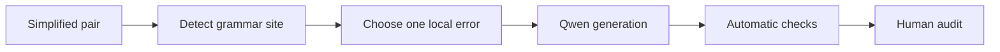

# Fluency degradation

[Methodology index](MULTI_AXIS_CORPUS.md) · [pilot report](PILOT_REPORT.md)

## Goal

Introduce exactly one local grammatical error without changing meaning or another simplification operation. The simplified version receives `FLUENCY = 1`; the degraded version receives `FLUENCY = 0`.

## Eligible pairs

Any unassigned single-strategy pair whose simplified version contains an auxiliary, determiner, preposition, or at least five words.

## Degradation workflow

The detector selects agreement, determiner, preposition, or local word-order corruption. Qwen applies it with [`fluency_degradation_v1.json`](../prompts/fluency_degradation_v1.json).

## Acceptance checks

- one visible grammatical error
- unchanged propositions and lexical meaning
- declared edit occurs in the output

## Pilot evaluation

| Automatic result | Count | Rate |
|---|---:|---:|
| Good | 10 | 20% |
| Medium | 23 | 46% |
| Failed | 17 | 34% |

Automatic structural triage of 50 cases; semantic human audit is pending.

## What we learned

The model often declared a fluency edit without actually changing the sentence.

**Next change:** Use deterministic local edits where possible and compare the declared source and replacement spans directly.
