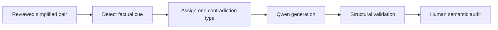

# Meaning degradation

[Methodology index](MULTI_AXIS_CORPUS.md) · [pilot report](PILOT_REPORT.md)

## Goal

Create one fluent but factually incorrect version while preserving every other simplification property. The simplified version receives `MEANING = 1`; the degraded version receives `MEANING = 0`.

## Eligible pairs

Any reviewed English pair with one source strategy and an explicit entity, number, date, negation, property, relation, or event cue. Evaluation corpora are excluded.

## Degradation workflow

The detector proposes a cue and balances applicable corruption types. Qwen uses [`meaning_severe_v2.json`](../prompts/meaning_severe_v2.json) to introduce one explicit contradiction. A reviewer accepts, retries, corrects, or rejects it.

## Acceptance checks

- exactly one factual contradiction
- all other facts and the source strategy remain unchanged
- fluent output with a verifiable replacement

## Pilot evaluation

| Result | Count | Rate |
|---|---:|---:|
| Accepted first pass | 20 | 40% |
| Accepted stricter retry | 11 | 22% |
| Manually corrected | 19 | 38% |
| **Final accepted** | **50** | **100%** |

Human audit. The final 100% follows correction; it is not the model's unaided success rate.

## What we learned

Structural validation was insufficient: 19/50 cases still required manual correction after two model passes.

**Next change:** Constrain replacements to detector-provided candidates, verify contradiction against the original, and reject outputs whose declared edit is absent.
