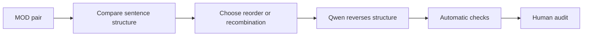

# Modulation degradation

[Documentation index](../README.md) · [methodology overview](../overview.md) · [pilot report](../reports/pilot_report.md)

## Goal

Undo one helpful restructuring by restoring original clause order or recombining a helpful split. The simplified version receives `MOD = 1`; the degraded version receives `MOD = 0`.

## Eligible pairs

Only pairs with the single Phase 3a `source_strategy = MOD`; all are protected for this axis.

## Degradation workflow



### Workflow blocks

| Block | Main idea |
|---|---|
| A — Input | A pair whose only detected source strategy is MOD. |
| B — Compare | Identify a helpful sentence split or information-order change. |
| C — Choose | Select one split to recombine or one order change to reverse. |
| D — Generate | Qwen moves the Simplified structure closer to the Original. |
| E — Check | Verify substantive structural change and the declared operation. |
| F — Audit | Confirm structure worsened while meaning, vocabulary, and fluency stayed stable. |

The pilot assigns a general restructuring reversal rather than an exact structural span. Qwen compares both texts and attempts one recombination or reordering.

## Labels and values sent to Qwen

| Field | Meaning | Example |
|---|---|---|
| `source_strategy` | Required Phase 3a label for this direct assignment. | `MOD` |
| `target_axis` | Phase 6 dimension selected for degradation. | `MOD` |
| `assigned_operation` | Instruction to undo helpful restructuring. | `reverse_information_restructuring` |
| `target_cue` | Generic structural cue used in the pilot. | `sentence structure` |

```text
source_strategy: MOD
target_axis: MOD
assigned_operation: reverse_information_restructuring
target_cue: sentence structure
        ↓ prompt
Qwen attempts one recombination or reordering
```

This is a direct protected assignment: every `MOD` pair is reserved for Modulation. Qwen receives Original, Simplified, `assigned_operation`, and the generic cue, but not the strategy label itself.

### Implementation links

- [Attach `source_strategy`](../../src/selection/select_multi_axis_inputs.py#L99-L101)
- [Build the Modulation operation](../../src/planning/multi_axis.py#L112-L113)
- [Protect MOD during allocation](../../src/planning/multi_axis.py#L159-L173)
- [Choose and store operation and cue](../../src/planning/multi_axis.py#L177-L207)
- [Insert operation and cue into the prompt](../../src/generation/generate_degradations.py#L136-L152)
- [Versioned Modulation prompt](../../prompts/mod_degradation_v1.json)

## Prompt used in the pilot

Exact version: [`mod_degradation_v1.json`](../../prompts/mod_degradation_v1.json).

<details>
<summary>Show prompt</summary>

**System**

```text
You create controlled negative examples for text-simplification research. Return only one valid JSON object. Do not add commentary.
```

**User template**

```text
Original: {original}
Clean simplification: {clean_simplification}
Assigned operation: {assigned_operation}
Target cue: {target_cue}

Undo only the helpful information restructuring: move the clean text closer to the original clause order or recombine a helpful sentence split. Preserve meaning, vocabulary difficulty, explanation, omission, and fluency. Return keys degraded_simplification, changed_span, replacement_span, operation_type, and brief_verification. operation_type must be exactly {assigned_operation}.
```

</details>

## Acceptance checks

- a helpful split or order change is actually reversed
- meaning and vocabulary remain unchanged
- the result stays grammatical

## Pilot evaluation

| Automatic result | Count | Rate |
|---|---:|---:|
| Good | 23 | 46% |
| Medium | 24 | 48% |
| Failed | 3 | 6% |

Automatic structural triage of 50 cases; semantic human audit is pending.

## What we learned

Three cases changed only formatting, and 24/50 substantive edits could not be verified from the declared spans.

**Next change:** Detect the structural operation before prompting and validate clause order or sentence-boundary changes explicitly.
