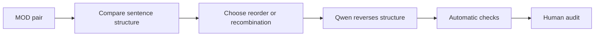

# Modulation degradation

[Methodology index](MULTI_AXIS_CORPUS.md) · [pilot report](PILOT_REPORT.md)

## Goal

Undo one helpful restructuring by restoring original clause order or recombining a helpful split. The simplified version receives `MOD = 1`; the degraded version receives `MOD = 0`.

## Eligible pairs

Only pairs with the single Phase 3a `source_strategy = MOD`; all are protected for this axis.

## Degradation workflow

The current detector assigns a general restructuring reversal rather than an exact span. Qwen compares both texts through [`mod_degradation_v1.json`](../prompts/mod_degradation_v1.json).

## Acceptance checks

- a helpful split or order change is actually reversed
- meaning and vocabulary remain unchanged
- the result stays grammatical

## Pilot evaluation

| Automatic result | Count | Rate |
|---|---:|---:|
| Good | 23 | 46% |
| Medium | 24 | 48% |
| Failed | 3 | 6% |

Automatic structural triage of 50 cases; semantic human audit is pending.

## What we learned

Three cases changed only formatting, and 24/50 substantive edits could not be verified from the declared spans.

**Next change:** Detect the structural operation before prompting and validate clause order or sentence-boundary changes explicitly.
