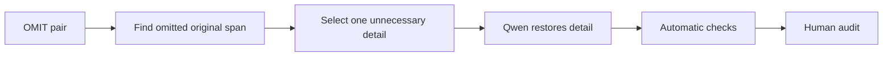

# Omission degradation

[Methodology index](MULTI_AXIS_CORPUS.md) · [pilot report](PILOT_REPORT.md)

## Goal

Undo one useful omission by restoring unnecessary or audience-inappropriate information. The simplified version receives `OMIT = 1`; the degraded version receives `OMIT = 0`.

## Eligible pairs

Only pairs with the single Phase 3a `source_strategy = OMIT`.

## Degradation workflow

The detector proposes original tokens absent from the simplified version. Qwen restores one detail with [`omit_degradation_v1.json`](../prompts/omit_degradation_v1.json).

## Acceptance checks

- restored text is present in the original
- the detail was usefully omitted
- no invented fact or second degradation

## Pilot evaluation

| Automatic result | Count | Rate |
|---|---:|---:|
| Good | 8 | 16% |
| Medium | 14 | 28% |
| Failed | 28 | 56% |

Automatic structural triage of 50 cases; semantic human audit is pending.

## What we learned

Token difference is a weak proxy for an omitted detail, and more than half of outputs failed.

**Next change:** Extract a contiguous source span, verify that it is absent from the simplified version, and require the restored span literally in the output.
