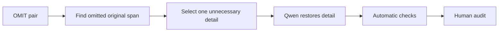

# Omission degradation

[Methodology index](MULTI_AXIS_CORPUS.md) · [pilot report](PILOT_REPORT.md)

## Goal

Undo one useful omission by restoring unnecessary or audience-inappropriate information. The simplified version receives `OMIT = 1`; the degraded version receives `OMIT = 0`.

## Eligible pairs

Only pairs with the single Phase 3a `source_strategy = OMIT`.

## Degradation workflow



### Workflow blocks

| Block | Main idea |
|---|---|
| A — Input | A pair whose only detected source strategy is OMIT. |
| B — Detect | Find original content absent from the Simplified sentence. |
| C — Select | Choose one omitted detail that was unnecessary for the target reader. |
| D — Generate | Qwen restores only that original detail. |
| E — Check | Verify a substantive change, matching operation, and literal restored span. |
| F — Audit | Confirm the detail was usefully omitted and no other axis changed. |

The detector currently proposes original tokens absent from the Simplified sentence. Qwen is asked to restore one candidate detail without inventing content.

## Prompt used in the pilot

Exact version: [`omit_degradation_v1.json`](../prompts/omit_degradation_v1.json).

<details>
<summary>Show prompt</summary>

**System**

```text
You create controlled negative examples for text-simplification research. Return only one valid JSON object. Do not add commentary.
```

**User template**

```text
Original: {original}
Clean simplification: {clean_simplification}
Assigned operation: {assigned_operation}
Candidate original detail: {target_cue}

Undo only the useful omission by restoring one unnecessary or audience-inappropriate detail from the original. Preserve meaning, fluency, and every other simplification choice. Do not invent information and do not remove necessary content. Return keys degraded_simplification, changed_span, replacement_span, operation_type, and brief_verification. operation_type must be exactly {assigned_operation}.
```

</details>

## Acceptance checks

- restored text is present in the original
- the detail was usefully omitted
- no invented fact or second degradation

## Pilot evaluation

| Automatic result | Count | Rate |
|---|---:|---:|
| Good | 7 | 14% |
| Medium | 13 | 26% |
| Failed | 30 | 60% |

Automatic structural triage of 50 cases; semantic human audit is pending.

## What we learned

Token difference is a weak proxy for an omitted detail, and more than half of outputs failed.

**Next change:** Extract a contiguous source span, verify that it is absent from the simplified version, and require the restored span literally in the output.
