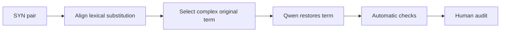

# Synonymy degradation

[Methodology index](MULTI_AXIS_CORPUS.md) · [pilot report](PILOT_REPORT.md)

## Goal

Undo one helpful lexical simplification by restoring a more complex original expression. The simplified version receives `SYN = 1`; the degraded version receives `SYN = 0`.

## Eligible pairs

Only pairs with the single Phase 3a `source_strategy = SYN`.

## Degradation workflow



### Workflow blocks

| Block | Main idea |
|---|---|
| A — Input | A pair whose only detected source strategy is SYN. |
| B — Align | Identify the simple expression and its more complex original counterpart. |
| C — Select | Choose one semantically equivalent but harder original expression. |
| D — Generate | Qwen restores only that expression. |
| E — Check | Verify a substantive lexical change and literal replacement. |
| F — Audit | Confirm equivalence, greater complexity, grammaticality, and one-axis change. |

The pilot detector uses original tokens absent from the Simplified sentence as candidate expressions. This approximation must be replaced by phrase alignment before scaling.

## Prompt used in the pilot

Exact version: [`syn_degradation_v1.json`](../prompts/syn_degradation_v1.json).

<details>
<summary>Show prompt</summary>

**System**

```text
You create controlled negative examples for text-simplification research. Return only one valid JSON object. Do not add commentary.
```

**User template**

```text
Original: {original}
Clean simplification: {clean_simplification}
Assigned operation: {assigned_operation}
Candidate original expression: {target_cue}

Undo exactly one helpful synonym replacement by restoring its more complex original expression. Preserve facts, grammar, and all other simplification operations. Return keys degraded_simplification, changed_span, replacement_span, operation_type, and brief_verification. operation_type must be exactly {assigned_operation}.
```

</details>

## Acceptance checks

- expressions are semantically equivalent
- the restored expression is more difficult
- grammar, facts, and other operations remain unchanged

## Pilot evaluation

| Automatic result | Count | Rate |
|---|---:|---:|
| Good | 6 | 12% |
| Medium | 12 | 24% |
| Failed | 32 | 64% |

Automatic structural triage of 50 cases; semantic human audit is pending.

## What we learned

Unaligned token difference does not reliably identify a synonym substitution; this axis had the lowest good rate.

**Next change:** Add word/phrase alignment plus semantic-equivalence and lexical-complexity checks before generation.
