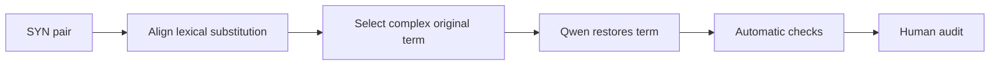

# Synonymy degradation

[Methodology index](MULTI_AXIS_CORPUS.md) · [pilot report](PILOT_REPORT.md)

## Goal

Undo one helpful lexical simplification by restoring a more complex original expression. The simplified version receives `SYN = 1`; the degraded version receives `SYN = 0`.

## Eligible pairs

Only pairs with the single Phase 3a `source_strategy = SYN`.

## Degradation workflow

The current detector proposes original tokens absent from the simplified version. Qwen restores one expression with [`syn_degradation_v1.json`](../prompts/syn_degradation_v1.json).

## Acceptance checks

- expressions are semantically equivalent
- the restored expression is more difficult
- grammar, facts, and other operations remain unchanged

## Pilot evaluation

| Automatic result | Count | Rate |
|---|---:|---:|
| Good | 6 | 12% |
| Medium | 12 | 24% |
| Failed | 32 | 64% |

Automatic structural triage of 50 cases; semantic human audit is pending.

## What we learned

Unaligned token difference does not reliably identify a synonym substitution; this axis had the lowest good rate.

**Next change:** Add word/phrase alignment plus semantic-equivalence and lexical-complexity checks before generation.
